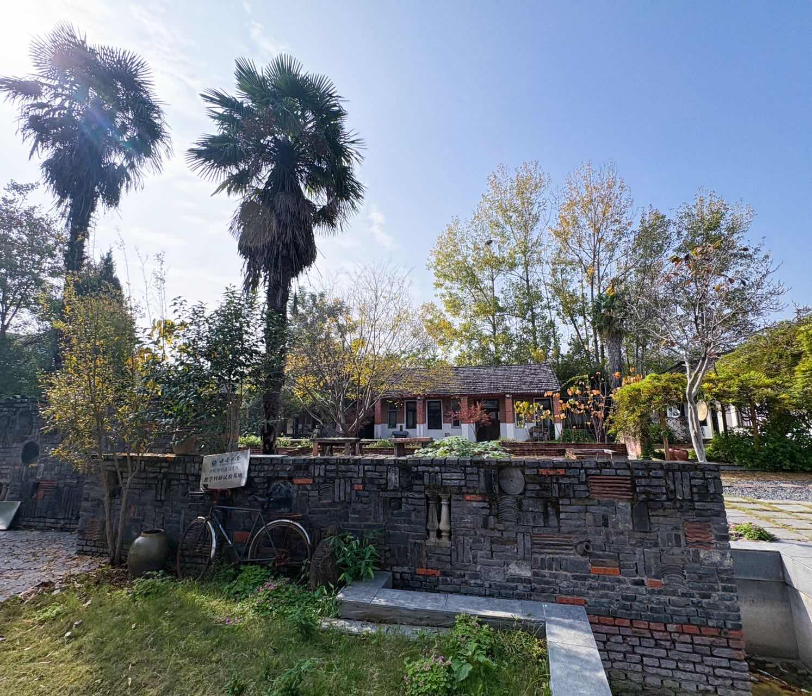
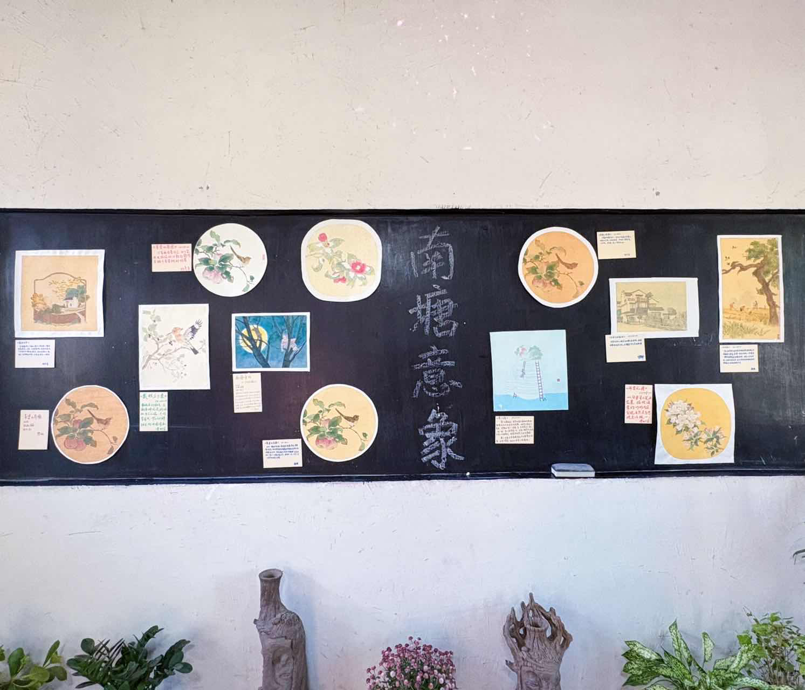

# Semi and Bai in the Field: Nantang and the Nantang Art Co-creation Camp

## A village that works things out together

Nantang Village in Fuyang, Anhui, is a village with a tradition of settling its own affairs. Around 1998, villagers began organizing themselves around problems they all faced; in 2003 an elders' association and a women's cultural troupe were founded one after the other, and in 2004 the Nantang Xingnong Cooperative was established on that foundation. From then until now, the people here have been practicing rural collaboration for more than twenty years. Nantang also has a well-known set of "Radish & Cabbage Rules," derived from the American Robert's Rules of Order and condensed in 2008 by Yuan Tianpeng, a promoter of rules of deliberation, together with the cooperative into a "Nantang Thirteen Rules" that villagers could actually remember. The village elders could not pronounce "Robert" properly, so they laughingly called it "Radish & Cabbage," and the name stuck. The rules are all in plain speech: the chair only manages the process and does not offer opinions; whatever is discussed must be a concrete, actionable proposal; you raise your hand before speaking, and each turn lasts no more than two minutes; no going off topic and no personal attacks; and a proposal passes only when more people are for it than against it. With these rules, the villagers learned something that looks simple but is in fact very hard: how to hold a good meeting. Long before digital technology arrived here, the seeds of democracy and collaboration had already been sown in this soil.

## Starting from a tool for our "gather-and-see" friends

In 2024, a group of young people who cared about public affairs and knew their way around blockchain came to the village to live and work alongside the villagers, and that August the Nantang DAO was formally established. Since then, returning young villagers, interns, digital nomads and remote participants have joined one after another and become the main force working in Nantang today. The encounter between the developer community and Nantang also happened naturally along the way. At first we only wanted to make a handy tool for the friends who gather with us — something that could record contributions, publish tasks, and make every bit of effort visible. That is how Semi came about, a digital identity you can log into with a phone number or email address, and how Bai came about, a community collaboration assistant that puts task publishing, claiming, verification and point distribution online end to end. Semi handles "who you are"; Bai handles "what you have done for the community." Together they form a complete piece of community collaboration infrastructure.

## Phase Three: a real stress test

The first two phases of the Nantang Art Co-creation Camp had already shown that "art + community + points" could work, but they left one problem unsolved: the points system stayed stuck at manual operation. Tasks were announced by shouting, claimed through sign-up lists, and NT was paid out from notes kept in a notebook; once the camp ended and the ledger closed, who had done what and earned how much rested on a few people's memory. The biggest difference in Phase Three was that the NT task system ran formally on a web platform for the first time, putting the whole flow of publishing, claiming, verification and NT distribution online. This was not a concept demo but a real stress test of 20 people × 17 days. Every co-creator who came had a Semi digital identity, registered with a phone number or email — no need to understand blockchain, no need to remember a password, not even a need to know what a "chain" is. They simply logged into Bai to see what tasks were available that day, uploaded proof when done, and had the points credited once the work was approved.

## 555 task records, 24,293 NT in circulation

Over 17 days the system produced 555 task records and 24,293 NT in circulation, with no major failures within those 20 days. Behind these numbers is a complete collaboration workflow running end to end: co-creators logged in through Semi and entered Bai, found tasks in the task plaza sorted by tag, deadline and points, and claimed them with one click. A task moved through "unclaimed → claimed → pending submission → under review → completed," and a rejected submission could be resubmitted, with the whole process kept on the task timeline. Once a task was completed, NT was issued to the co-creator's Semi account, and co-creators then exchanged NT for food and lodging at 40 NT per day, forming a loop of "labor → NT → payment for food and lodging → recovery by the cooperative." In the process, the cooperative came to clearly recognize the value of how often NT circulates — every additional circulation of NT is another moment of real collaboration. That sentence later went into the final report; it is not a slogan but an insight that grew out of 17 days of actual operation.

## Moments that went beyond expectations

More than one thing went beyond expectations. During the camp, local partners and co-creators published 17+ tasks on their own initiative; the task system was no longer merely a tool for the organizers to manage the camp but was actively used by community members as everyday collaboration infrastructure, offering real proof of the value of decentralized task publishing. The decision to extend the painting exhibition went through the full process of "individual idea → collective motion → debate → vote and passage": the rules of deliberation settled "how to deliberate," while Bai settled "who did what and how many points were issued," and the two complemented each other in real collaboration. On another occasion, 10 co-creators collectively applied for a 3-day extension because their creative work was behind schedule, and the request was approved on the condition that they pay staff 1,250 NT for the extra time. NT was no longer only a one-way incentive of "the organizers issue, the co-creators receive"; it flowed in reverse in a negotiation, becoming a channel for expressing and trading real needs. Participation in the morning standing meditation, walking meditation and sutra copying at Sushe reached 89%, and participation in the quiet-time sessions reached 80%; these figures later became important inputs for the next iteration of the system.

## The system iterates in live use

The co-creation camp submitted bug reports and improvement requests to the developer community. These included the review efficiency bottleneck — there was no batch operation for reviewing, transfers had to be clicked one by one, and when teaching and reviewing fell to a single person a bottleneck formed; the need for task templates — proof requirements varied considerably across task types, so more flexible template configuration was needed; and improved notifications — key moments such as a rejected task or points being credited needed a clearer notification mechanism. This feedback feeds directly into the next round of iteration for the Bai task system. On the Semi side we are also continuing to grow: we will later connect more external wallets such as imToken so that users can log in with the wallet they are used to instead of having to entrust their private keys to the system. The task system will add more login methods, and an on-chain staking feature is being refined, so that in future a publisher can lock the reward in a contract first and release it to the claimant only after verification, with any unfinished portion returned proportionally — making money in the community truly "held in escrow first, released later."

## A model you can take away

The significance of Phase Three is not only that the system worked, but that it proved a replicable model. Participants do not need to understand blockchain; they can log in with a phone number; every contribution has a clear timeline; points circulate genuinely within the community rather than being issued one-way; and any village, cooperative, community or interest group can organize its own collaboration in the same way. The Phase Three practice in Nantang offers a reference model for the wider adoption of Semi and Bai — not a concept demo, but real data from 20 days, 555 task records and 24,293 NT in circulation. The developer community's tool gave Nantang a starting point, and Nantang's field practice gave us an answer; and the starting point of all this was 17 days in a village, 10 co-creators, 4 staff members, and one simple idea: let every bit of effort made for the community be seen and remembered. We will keep iterating and keep growing, so that this system can take root in more villages and more communities.
