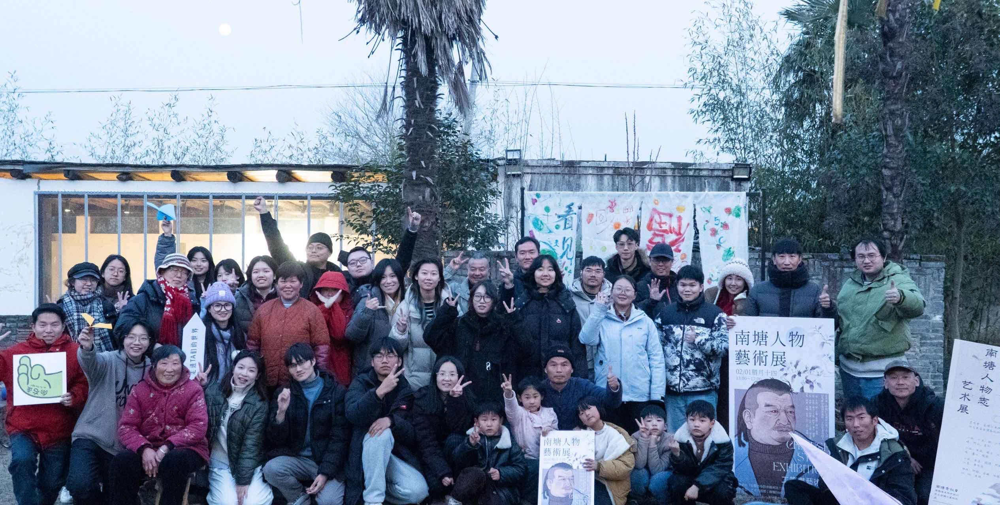
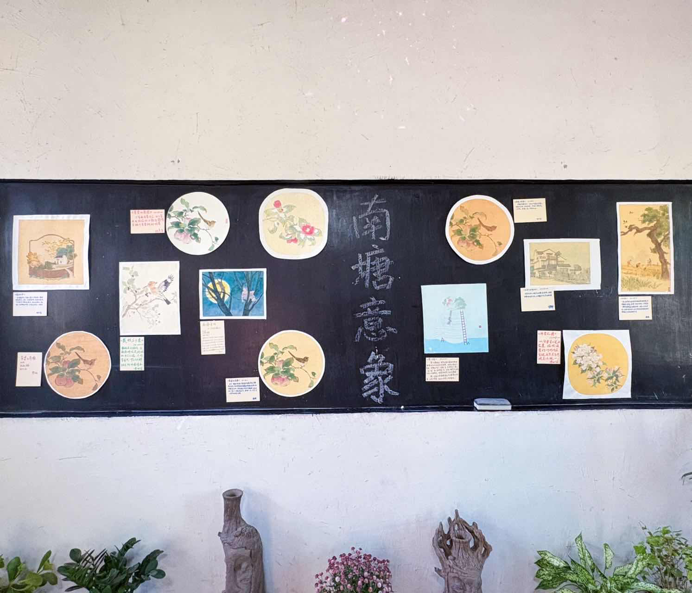

# Semi 与 Bai 实地应用实例：南塘与南塘艺术共创营

## 一个会自己商量事的村子

安徽阜阳的南塘村，是一个有“自己商量事”传统的村子。1998年前后，村民们为了共同面对的难题自发组织起来，2003年老年协会和妇女文艺队相继成立，2004年大家在此基础上成立了南塘兴农合作社。从那时到现在，这里的人们在乡村协作上已经走了二十多年。南塘还有一套很有名的“萝卜白菜规则”，它来自美国的《罗伯特议事规则》，2008年由议事规则推广者袁天鹏和合作社一起精简成村民记得住的“南塘十三条”。村里的老人念不准“罗伯特”，就笑着叫它“萝卜白菜”，名字就这样传开了。这套规则说的都是大白话：主持人只管流程不发表意见，讨论的必须是具体能落地的提议，发言先举手每人每次不超过两分钟，不许跑题不许人身攻击，赞成的人比反对的人多才算通过。村民们靠这套规则，学会了一件看似简单其实很难的事：好好开会。在数字技术来到这里之前，民主和协作的种子早就埋在了这片泥土里。

## 从相见小伙伴的工具说起

2024年，一群关心公共事务、熟悉区块链的年轻人来到村里，和村民一起生活、一起做事，这一年8月南塘DAO正式成立。此后返乡青年、实习生、数字游民和远程参与的伙伴陆续加入，成了今天在南塘做事的主力。开发者社区与南塘的相遇，也是在这个过程里自然发生的。我们最初只是想给相见的小伙伴做一个趁手的工具——一个能记录贡献、能发任务、能让每一份付出都被看见的东西。于是有了 Semi，一个用手机号或邮箱就能登录的数字身份；也有了 Bai，一个把任务发布、领取、验收、积分发放全流程搬到线上的社区协作助手。Semi 管“你是谁”，Bai 管“你为社区做了什么”，两者合在一起，就是一套完整的社区协作基础设施。

## 第三期，一次真实的压力测试

南塘艺术共创营前两期已经初步验证了“艺术+社区+积分”这件事是能跑通的，但也留下了一个没解决的问题：积分系统始终停留在手动操作阶段，任务发布靠喊，领取靠接龙，NT发放靠人记在本子上，营期一结束账本一合，谁做了什么拿了多少全靠几个人的记忆撑着。第三期的最大不同，就是 NT 任务系统第一次在网页平台上正式运行，任务发布、领取、验收、NT发放全流程线上化。这不是一次概念演示，而是一场20人×17天的真实压力测试。来的共创人每个人都有一个 Semi 数字身份，用手机号或邮箱注册，不需要懂区块链，不需要记密码，甚至不需要知道“链”是什么东西，登录 Bai 就能看到今天有什么任务可以领，做完上传凭证，审核通过积分就到账了。

## 555条任务记录，24,293 NT流转

17天下来，系统跑出了555条任务记录，24,293 NT流转，20天内无重大故障。这些数字背后是一整套协作流程的完整跑通：共创人用 Semi 登录进入 Bai，在任务广场按标签、截止时间、积分排序找任务，一键领取；任务沿“未领取→已领取→待提交→审核中→已完成”流转，被驳回还能重新提交，全过程留在任务时间线上；任务完成即发放 NT 至 Semi 账户，共创人再用 NT 兑换食宿，40 NT一天，形成“劳动→NT→食宿支付→合作社回收”的闭环。合作社在这个过程中清晰认识到了 NT 流通次数的价值——NT每多流通一次，就是一次真实协作的发生，这句话后来被写进了结项报告，它不是一句口号，而是从17天真实运转里自己长出来的认知。

## 那些超出预期的时刻

超出预期的事情发生了不止一件。营期里在地伙伴和共创人自发发布了17+项任务，任务系统不再只是主办方用来管理营队的工具，而是被社区成员主动用作了日常协作的基础设施，去中心化任务发布的价值得到了真实验证。画展延期决策走完了“个人想法→集体动议→辩论→投票通过”的完整过程，议事规则解决“怎么商量”，Bai 解决“谁做了什么、发了多少积分”，两者在真实协作中形成了互补。还有一次，10位共创人因创作进度滞后集体申请延期3天，并以支付工作人员延时 NT 1,250 为前置条件获得通过，NT 不再只是“主办方发、共创人领”的单向激励，它在协商场景中反向流动，成了真实需求的表达和置换通道。素社之晨的站桩、行禅、抄经参与率达到了89%，静心时刻参与率80%，这些数据后来都成了系统迭代的重要输入。

## 系统在实战中迭代

共创营向开发者社区提交了 Bug 记录与优化需求，包括审核效率瓶颈——审核无批量操作、转账需逐笔点击，教学与审核集中于一人时形成瓶颈；任务模板需求——不同类型任务的凭证要求差异较大，需更灵活的模板配置；以及消息通知优化——任务被驳回、积分到账等关键节点需更清晰的通知机制。这些反馈直接服务于 Bai 任务系统的下一轮迭代。而 Semi 这边，我们也在持续成长，后续会接入 imToken 等更多外部钱包，让用户可以用自己习惯的钱包登录而不必把私钥托管在系统里；任务系统会增加更多登录方式，链上质押功能也在完善中，未来发布者可以先把赏金锁定在合约里，验收通过才放款给领取人，未完成的部分按比例退回，让社区里的钱真正实现“先托管、后放款”。

## 一套可以带走的模式

第三期的意义不只在于系统跑通了，更在于它证明了一套可复制的模式。参与者不需要理解区块链，用手机号就能登录，每一份贡献都有明确的时间线，积分在社区内部形成真实循环而不是单向发放，任何村庄、合作社、社区或兴趣小组都可以用同样的方式组织自己的协作。南塘第三期的实践为 Semi 与 Bai 的后续推广提供了一个可参照的范本——不是概念演示，而是20天、555条任务记录、24,293 NT流转的真实数据。开发者社区的工具给了南塘一个起点，南塘的实战给了我们一个答案，而这一切的起点，是一个村子里的17天，10个共创人，4个工作人员，和一个简单的想法：让每一份为社区出的力，都能被看见、被记住。我们也会继续迭代，继续成长，让这套系统在更多乡村、更多社区里扎根。
